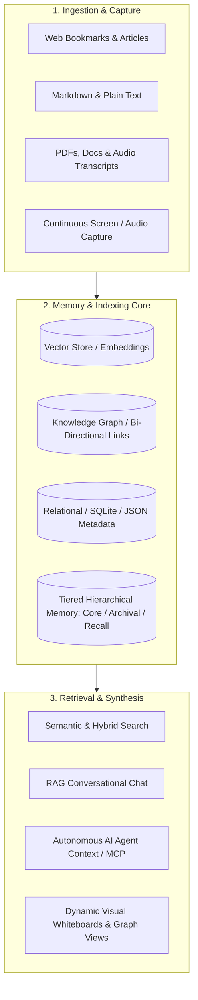

# Awesome-AI-Second-Brain-Long-Term-Memory

<div align="center">

# 🧠 Awesome AI Second Brain & Long-Term Memory Ecosystem

[](https://awesome.re)
[](https://github.com/ishandutta2007/Awesome-AI-Second-Brain-Long-Term-Memory/stargazers)
[](http://creativecommons.org/publicdomain/zero/1.0/)
[](https://github.com/ishandutta2007/Awesome-AI-Second-Brain-Long-Term-Memory/pulls)

**A curated index of top SaaS platforms and open-source GitHub projects powering AI Personal Knowledge Management (PKM), local-first knowledge graphs, persistent AI memory architectures, bi-directional note-taking, and self-hosted digital brains.**

*Last updated: November 2026*

</div>

---

## 📌 Executive Summary & Repository Purpose

This repository tracks the rapidly expanding frontier of **AI Second Brains & Long-Term Memory (LTM)** systems. These applications bridge human thought and machine intelligence: capturing web bookmarks, research papers, Markdown notes, audio transcripts, PDFs, and conversations into unified, queryable knowledge graphs. Equipped with vector embeddings, semantic search, hybrid graph traversal, and MCP (Model Context Protocol) interfaces, these tools enable autonomous recall, continuous associative context, and lifetime knowledge retention for knowledge workers, developers, and AI agents alike.

---

## 📑 Table of Contents

- [Sector Overview & Market Dynamics](#-sector-overview--market-dynamics)
- [SaaS / Hosted Platforms](#-saashosted-platforms)
- [Open-Source GitHub Projects](#-open-source-github-projects)
- [Key Architectural Paradigms](#-key-architectural-paradigms)
- [How to Choose the Right Second Brain](#-how-to-choose-the-right-second-brain)
- [How to Contribute](#-how-to-contribute)
- [Disclaimer](#-disclaimer)

---

## 📊 Sector Overview & Market Dynamics

The personal AI knowledge management and second brain market is valued at approximately **$1.65B to $2.16B in 2025–2026**, projected to surge past **$6.15B by 2030 at a ~30% CAGR** (with the broader AI-enhanced enterprise knowledge market exceeding **$190B+ by 2034**). The sector exhibits **moderate-to-high fragmentation** characterized by a dual-tier ecosystem: high-valuation horizontal workspace incumbents (like Notion) capture enterprise workflows, while a resilient, thriving constellation of specialized indie SaaS platforms and local-first open-source engines dominate power-user, privacy-centric, and agentic memory niches. Switching costs and personal data friction prevent a single "winner-take-all" outcome, creating strong long-term defensibility for local-first and interoperable architectures.

---

## ☁️ SaaS/Hosted Platforms

The table below catalogs premier hosted AI Second Brain and networked thought tools, sorted in **descending order by company scale (valuation / estimated ARR)**.

| Product | Scale (Valuation / Revenue) | Starting Price (Paid) | Free Tier / Trial Limits | Core Capabilities & Differentiators |
| :--- | :--- | :--- | :--- | :--- |
| **[Notion AI](https://notion.so)** | **~$10B Valuation** (~$300M+ ARR) | $8/member/month (billed annually) or $10 billed monthly (+ $8–$10/user/mo for Notion AI add-on) | **Free Forever plan**: Unlimited pages & blocks for solo users (capped at 1,000 blocks lifetime if 2+ members join workspace); 5 MB max file upload limit; 7-day page version history; up to 10 guests; trial quota of AI queries included. | All-in-one connected workspace and relational knowledge base featuring workspace-wide semantic Q&A, automatic database property autofill, and enterprise cross-tool search connectors. |
| **[Obsidian Sync & Publish](https://obsidian.md)** | **~$25M ARR** (Bootstrapped, ~$350M estimated implied valuation) | $4/month (Sync Standard billed annually) or $5 billed monthly; Publish at $8/site/month | **Core app is 100% Free Forever** (local-first Markdown files, no note or file caps, community AI/RAG plugins). Official Sync add-on has **no free tier** (standard tier starts at $4/mo with 1 synced vault, 1 GB storage, 5 MB file size limit, and 1-month version history). | Privacy-first, local-first plain Markdown knowledge graph editor with massive community plugin ecosystem, Canvas visual boards, and end-to-end encrypted zero-knowledge cloud sync. |
| **[Roam Research](https://roamresearch.com)** | **~$200M Valuation** (~$3M–$5M ARR) | $15/month (billed monthly) or $165/year ($13.75/mo equivalent); Believer 5-yr at $500 | **No permanent free tier**. Offers a **31-day fully functional free trial** with unlimited graphs, block references, graph visualizations, and daily notes (credit card required at expiration to maintain editing access). | Pioneer of networked thought and outliner note-taking built around bi-directional block-level linking, daily journal pages, graph queries, and relational knowledge mapping. |
| **[Mem.ai](https://mem.ai)** | **$110M Valuation** (~$4M estimated ARR, backed by OpenAI Startup Fund) | $14.99/month (or $179 billed annually) | **Legacy Free plan**: Capped at 25 new notes/month, 25 Mem Chat AI messages/month, 3 hours voice mode/month, and 25 PDF pages/month. *(Note: Mem is winding down consumer operations toward a scheduled January 2027 transition, with notes moving read-only in December 2026).* | AI-native self-organizing notes platform that automatically connects disparate thoughts, resurfaces contextually relevant notes in real time, and synthesizes drafts from personal graphs. |
| **[Craft](https://craft.do)** | **~$7.6M ARR** ($20.2M total VC funding) | $8/month (Plus plan billed annually) or $10 billed monthly | **Free Forever Starter plan**: Limited to 1,500 total content blocks across the workspace, 1 GB storage space, 25 MB max per file upload, 1 personal space, 7-day version history, and introductory AI assistant credit balance. | Design-first document editor and personal knowledge base featuring structured nested sub-pages, daily notes, visual styling, multi-platform native apps, and integrated AI assistant writing tools. |
| **[Supermemory Cloud](https://supermemory.ai)** | **$3M Seed Funding** (Backed by Susa Ventures & prominent angel investors) | $19/month (Pro plan) | **Free Forever plan**: Includes **$5 of free usage credits per month** (sufficient for ~1M tokens plain text memory ingestion or ~1M queries), web extension bookmarking, and up to 10,000 local documents on self-hosted binaries. | Universal memory engine and personal knowledge hub connecting bookmarks, documents, Notion, and Google Drive with Model Context Protocol (MCP) clients for real-time AI retrieval. |
| **[MyMind](https://mymind.com)** | **~$880K ARR** (Bootstrapped, founder-owned) | $4.99/month (The Bookmarker); $7.99/month or $79/year (Student of Life AI tier) | **Free Forever Guest plan**: Strictly capped at **100 total cards** lifetime (across notes, images, quotes, and links); no time limit, but saving new content beyond 100 cards requires deletion or upgrading to paid tiers. | Private visual extension of your mind utilizing automated AI tagging, computer vision OCR, color-indexing, and semantic clustering without manual folders or tedious tagging chores. |
| **[Capacities](https://capacities.io)** | **~$440K ARR** (Bootstrapped, 100% founder-owned) | $9.99/month (Pro plan billed annually) or $11.99 billed monthly | **Free Forever Basic plan**: Unlimited notes, objects, spaces, custom types, and sync across desktop/mobile/web; capped at **5 GB total media upload storage** (restricted to 100 MB/month once reached); AI assistant requires Pro tier. | Object-based studio for thought and PKM organizing notes into typed entities (books, people, projects, ideas) with daily notes, network graph views, and AI assistant integrations. |
| **[Reflect](https://reflect.app)** | **~$326K ARR** ($1.39M seed funding, indie team) | $10/month (billed annually at $120/year) or $15 billed monthly | **No permanent free tier**. Offers a **14-day fully featured free trial** with no credit card required upfront (unlimited encrypted daily notes, calendar sync, and Whisper AI voice transcription). | Lightweight, ultra-fast networked note-taking application featuring end-to-end encryption, calendar integration, bi-directional backlinks, Whisper voice transcription, and LLM text transformations. |
| **[Amplenote](https://amplenote.com)** | **Bootstrapped / Indie** (<$1M ARR estimate) | $5.84/month (Pro plan billed annually) or $10 billed monthly | **Free Forever Personal plan**: Unlimited notes, tasks, jots, and device sync; capped at **5 MB max per file upload**; excludes external calendar 2-way sync, vault encryption, and visual graph view. | Unified Idea-to-Execution productivity system moving thoughts through a 4-mode funnel: rapid Jots, interconnected Notes, weighted Task lists, and time-blocked Calendar scheduling. |
| **[Fabric.so](https://fabric.so)** | **Seed Funded / Indie** | $8/month (Plus plan billed annually) or $10 billed monthly | **Paid Subscription only**: Introductory trial period for evaluation; requires active paid subscription for ongoing multi-device sync, cloud drive mounting, and AI search indexing. | AI-driven internet drive and digital brain that aggregates bookmarks, cloud files, screenshots, and PDFs with autonomous semantic search, visual canvases, and assistant Q&A. |

---

## 💻 Open-Source GitHub Projects

The following table presents top open-source projects for personal AI second brains, local knowledge graphs, and persistent agent memory layers, ordered in **descending order by GitHub star count**.

> **Note**: Click any GitHub star badge to explore its live stargazers community directly on GitHub.

| Repository | GitHub Stars Badge | License | Description & Key Features |
| :--- | :---: | :---: | :--- |
| **[ollama/ollama](https://github.com/ollama/ollama)** | [](https://github.com/ollama/ollama/stargazers) | `MIT` | The premier local runtime for running LLMs and multimodal vision models locally on macOS, Linux, and Windows; serves as the foundational inference engine powering offline second-brain RAG vaults. |
| **[AppFlowy-IO/AppFlowy](https://github.com/AppFlowy-IO/AppFlowy)** | [](https://github.com/AppFlowy-IO/AppFlowy/stargazers) | `AGPL-3.0` | Leading open-source Notion alternative built with Flutter and Rust; features local-first data ownership, relational databases, Kanban boards, offline encryption, and self-hosted AI agents. |
| **[toeverything/AFFiNE](https://github.com/toeverything/AFFiNE)** | [](https://github.com/toeverything/AFFiNE/stargazers) | `MIT` | Next-generation hyper-converged knowledge base merging structured docs, Miro-style edgeless whiteboards, and multimodal mind maps into a local-first canvas powered by offline-ready AI assistants. |
| **[mem0ai/mem0](https://github.com/mem0ai/mem0)** | [](https://github.com/mem0ai/mem0/stargazers) | `Apache-2.0` | Universal long-term memory layer for AI agents and personalized assistants; extracts, deduplicates, and continuously updates user preferences and episodic memory across LLM sessions. |
| **[Mintplex-Labs/anything-llm](https://github.com/Mintplex-Labs/anything-llm)** | [](https://github.com/Mintplex-Labs/anything-llm/stargazers) | `MIT` | Full-stack all-in-one desktop AI second brain and private RAG workspace; transforms Obsidian vaults, PDFs, and URLs into conversational chatbots with zero configuration and local LLM support. |
| **[usememos/memos](https://github.com/usememos/memos)** | [](https://github.com/usememos/memos/stargazers) | `MIT` | Privacy-first, ultra-lightweight self-hosted memo and micro-thought capture hub written in Go; features Markdown support, REST APIs, tags, and seamless integration into daily journaling workflows. |
| **[MemPalace/mempalace](https://github.com/MemPalace/mempalace)** | [](https://github.com/MemPalace/mempalace/stargazers) | `Apache-2.0` | Innovative structured AI memory architecture inspired by the classical Method of Loci ("Memory Palace"); encodes complex facts and retrieval cues into navigable spatial hierarchies for LLMs. |
| **[laurent22/joplin](https://github.com/laurent22/joplin)** | [](https://github.com/laurent22/joplin/stargazers) | `AGPL-3.0` | Battle-tested open-source cross-platform Markdown note-taking and to-do application with end-to-end encryption, web clipper extension, mobile sync, and community AI summarization plugins. |
| **[danny-avila/LibreChat](https://github.com/danny-avila/LibreChat)** | [](https://github.com/danny-avila/LibreChat/stargazers) | `MIT` | Enhanced open-source AI platform supporting multiple providers, autonomous agent memory, file search, multimodal RAG, and artifact code execution for managing persistent conversational knowledge. |
| **[siyuan-note/siyuan](https://github.com/siyuan-note/siyuan)** | [](https://github.com/siyuan-note/siyuan/stargazers) | `AGPL-3.0` | Privacy-centric personal knowledge management system with block-level bi-directional links, local Markdown/JSON storage, mind mapping, spaced repetition flashcards, and native AI writing integrations. |
| **[logseq/logseq](https://github.com/logseq/logseq)** | [](https://github.com/logseq/logseq/stargazers) | `AGPL-3.0` | Privacy-first, local-first outliner and networked thought platform operating directly on plain Markdown and Org-mode files; includes graph views, PDF annotations, flashcards, and AI plugin ecosystem. |
| **[QuivrHQ/quivr](https://github.com/The-Vibe-Company/quivr)** | [](https://github.com/The-Vibe-Company/quivr/stargazers) | `Apache-2.0` | Opinionated "Second Brain in the Cloud" RAG platform; connects personal files, docs, audio, and code snippets into customized cognitive brains queryable via generative AI models. |
| **[zadam/trilium](https://github.com/zadam/trilium)** | [](https://github.com/zadam/trilium/stargazers) | `AGPL-3.0` | Hierarchical personal knowledge base designed for massive note collections; features note cloning across hierarchies, attribute scripting, relation maps, revision history, and self-hosted web sync. |
| **[khoj-ai/khoj](https://github.com/khoj-ai/khoj)** | [](https://github.com/khoj-ai/khoj/stargazers) | `AGPL-3.0` | Self-hostable AI second brain and research assistant; continuously indexes local Markdown files, Obsidian vaults, Notion workspaces, PDFs, and GitHub repos for grounded semantic chat. |
| **[stanford-oval/storm](https://github.com/stanford-oval/storm)** | [](https://github.com/stanford-oval/storm/stargazers) | `MIT` | Stanford's LLM research synthesis system; automates in-depth information discovery from web citations, conducting multi-perspective research interviews to produce grounded Wikipedia-style knowledge syntheses. |
| **[supermemoryai/supermemory](https://github.com/supermemoryai/supermemory)** | [](https://github.com/supermemoryai/supermemory/stargazers) | `AGPL-3.0` | Open-source second brain for saving web bookmarks, documents, and Twitter threads into a unified canvas with semantic search and Model Context Protocol (MCP) server support for AI assistants. |
| **[hoarder-app/hoarder](https://github.com/karakeep-app/karakeep)** | [](https://github.com/karakeep-app/karakeep/stargazers) | `AGPL-3.0` | Self-hosted AI-first bookmarking and read-it-later engine (Karakeep); automatically scrapes web links, generates AI tags, runs OCR on screenshots/images, and archives full page contents offline. |
| **[letta-ai/letta](https://github.com/letta-ai/letta)** | [](https://github.com/letta-ai/letta/stargazers) | `Apache-2.0` | Stateful AI agent runtime and memory management platform (formerly MemGPT); equips LLMs with OS-style tiered virtual memory (`core`, `archival`, `recall`) for perpetual long-term context. |
| **[mediar-ai/screenpipe](https://github.com/screenpipe/screenpipe)** | [](https://github.com/screenpipe/screenpipe/stargazers) | `MIT` | 24/7 continuous local-first screen and audio capture engine; indexes every action, video frame, and meeting audio transcript locally to give personal AI second brains continuous semantic recall. |
| **[linkwarden/linkwarden](https://github.com/linkwarden/linkwarden)** | [](https://github.com/linkwarden/linkwarden/stargazers) | `AGPL-3.0` | Self-hosted collaborative bookmark manager with built-in archival capabilities; automatically preserves web pages as PDFs and visual snapshots to protect your knowledge base against link rot. |
| **[foambubble/foam](https://github.com/foambubble/foam)** | [](https://github.com/foambubble/foam/stargazers) | `MIT` | Extensible personal knowledge management and second brain workspace built on Visual Studio Code and Git-backed Markdown; inspired by Roam Research with zero vendor lock-in. |
| **[MODSetter/SurfSense](https://github.com/MODSetter/SurfSense)** [](https://github.com/MODSetter/SurfSense/stargazers) | `Apache-2.0` | Open-source alternative to NotebookLM; indexes web browsing history, Slack conversations, Notion docs, YouTube transcripts, and PDFs for hybrid BM25 + vector search and citation-backed Q&A. |
| **[anyproto/anytype-ts](https://github.com/anyproto/anytype-ts)** | [](https://github.com/anyproto/anytype-ts/stargazers) | `Available Source` | Local-first, peer-to-peer encrypted object-oriented workspace; connects notes, relations, and structured documents offline across devices using CRDTs without central server vulnerability. |
| **[reorproject/reor](https://github.com/reorproject/reor)** | [](https://github.com/reorproject/reor/stargazers) | `GPL-3.0` | Local desktop AI note-taking app that automatically embeds, relates, and links notes; powered completely offline using local models via Ollama and an embedded LanceDB vector database. |
| **[dendronhq/dendron](https://github.com/dendronhq/dendron)** | [](https://github.com/dendronhq/dendron/stargazers) | `Apache-2.0` | Hierarchical, schema-driven Markdown note-taking tool that operates as a VS Code extension; optimized for structuring, navigating, and refactoring tens of thousands of personal knowledge notes. |
| **[silverbulletmd/silverbullet](https://github.com/silverbulletmd/silverbullet)** | [](https://github.com/silverbulletmd/silverbullet/stargazers) | `MIT` | Extensible, hackable Markdown note-taking web application featuring live embedded SQL-like queries, Lua scripting, Progressive Web App (PWA) offline sync, and pluggable AI extension modules. |
| **[basicmachines-co/basic-memory](https://github.com/basicmachines-co/basic-memory)** | [](https://github.com/basicmachines-co/basic-memory/stargazers) | `AGPL-3.0` | Local-first Model Context Protocol (MCP) server; stores AI interactions and memory as human-readable Markdown notes indexed in SQLite, empowering Claude and Cursor with personal memory. |
| **[TriliumNext/Notes](https://github.com/TriliumNext/Notes)** | [](https://github.com/TriliumNext/Notes/stargazers) | `AGPL-3.0` | Actively maintained community continuation of Trilium Notes; provides advanced hierarchical organization, note encryption, code execution, scripting, and self-hosted synchronization. |

---

## 🔍 Key Architectural Paradigms

Understanding the underlying technical paradigms helps identify the right second brain strategy:



1. **Local-First vs. Cloud-Managed**:
   - *Local-First* (`Obsidian`, `Logseq`, `AppFlowy`, `Reor`, `SiYuan`): Your notes remain human-readable files on your local drive. Sync is optional, encrypted, and peer-to-peer.
   - *Cloud-Managed* (`Notion AI`, `Craft`, `Reflect`, `Mem.ai`): Instant multi-device sync and managed server-side AI inference, trading data sovereignty for friction-free collaboration.

2. **Graph / Networked Thought vs. Object-Oriented**:
   - *Networked Outliners* (`Roam Research`, `Logseq`, `Reflect`): Leverage block-level atomic references and bi-directional `[[backlinks]]` to form an emergent organic web.
   - *Object-Based Studios* (`Capacities`, `Anytype`): Treat thoughts as concrete typed entities (e.g., Books, Projects, People, Ideas) with structured metadata and relations.

3. **Universal AI Agent Memory (MCP & Middleware)**:
   - Systems like `Mem0`, `Letta`, `Supermemory`, and `Basic Memory` expose standardized memory APIs (such as Anthropic's Model Context Protocol), turning passive notes into active cognitive memory for LLM coding agents, research bots, and virtual assistants.

---

## 🧭 How to Choose the Right Second Brain

```
                                    What is your top priority?
                                                │
                 ┌──────────────────────────────┴──────────────────────────────┐
                 ▼                                                             ▼
        [Absolute Privacy & Data Ownership]                           [Collaboration & Instant Setup]
                 │                                                             │
        ┌────────┴────────┐                                           ┌────────┴────────┐
        ▼                 ▼                                           ▼                 ▼
 [Local Markdown]   [Local GUI App]                            [Enterprise Docs]  [Networked Daily Journal]
        │                 │                                           │                 │
  Obsidian / Logseq  AppFlowy / SiYuan                             Notion AI      Reflect / Roam Research
```

---

## 🤝 How to Contribute

Contributions to this ecosystem list are highly welcomed! Please adhere to these guidelines:
1. Ensure the platform or project directly addresses **AI Second Brains, Personal Knowledge Management (PKM), or Persistent AI Memory**.
2. For SaaS tools, provide exact pricing tiers, unambiguous free tier/trial boundaries, and company scale metrics.
3. For open-source repositories, specify the official GitHub repository, exact open-source license, and link to stargazers.
4. Follow the existing table formatting and keep descriptions concise, objective, and neutral.

Submit a pull request via the [GitHub Pull Requests portal](https://github.com/ishandutta2007/Awesome-AI-Second-Brain-Long-Term-Memory/pulls).

---

## ⚖️ Disclaimer

*All trademarks, logos, and brand names are the property of their respective owners. Company valuations, ARR figures, and pricing tiers reflect publicly disclosed funding reports, regulatory filings, or software intelligence estimates as of late 2026 and may evolve over time.*
